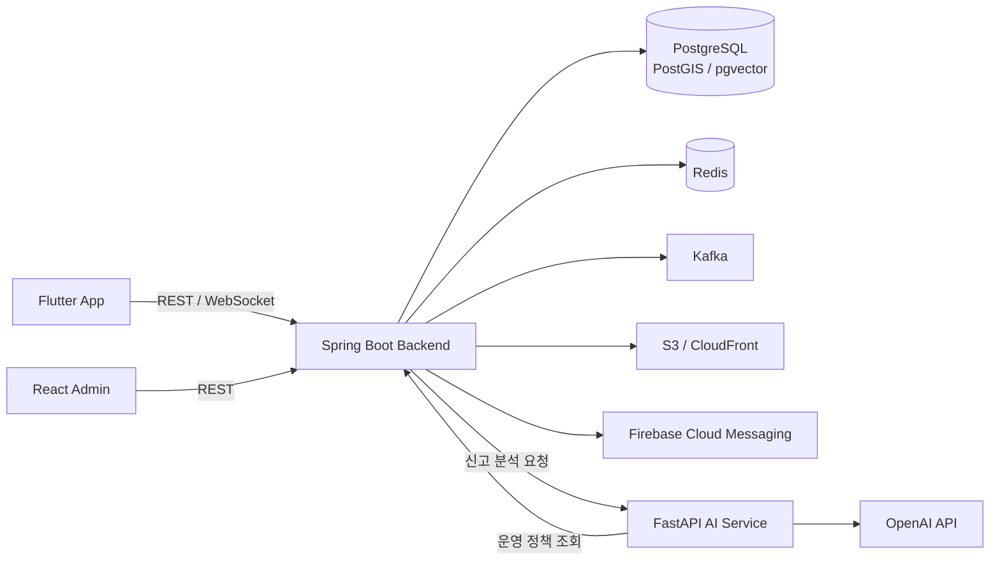

# Meetple

> 내 주변 모임을 탐색하고 직접 만들고 참여하며, 실시간 채팅으로 이어지는 위치 기반 소셜 모임 플랫폼

Meetple은 모바일 앱, API 서버, AI 서비스, 관리자 콘솔을 각각 독립된 저장소로 관리합니다.  
이 저장소는 전체 프로젝트를 한곳에서 소개하고 각 소스 저장소로 연결하는 프로젝트 허브입니다.

## 저장소

| 영역 | 역할 | 주요 기술 | 저장소 |
| --- | --- | --- | --- |
| Mobile App | 모임 탐색·생성·참여, 실시간 채팅, 푸시 알림 | Flutter, Dart, STOMP, Firebase Messaging, Naver Map | [meetple-app](https://github.com/taemin3/meetple-app) |
| Backend | 인증, 모임·채팅·신고 API, 실시간 메시징, 데이터 및 배포 인프라 | Java 21, Spring Boot, PostgreSQL/PostGIS, Redis, Kafka, WebSocket, AWS, Terraform | [meetple-backend](https://github.com/taemin3/meetple-backend) |
| AI | 운영 정책 기반 신고 분석 | Python, FastAPI, LangGraph, OpenAI API, MCP | [meetple-ai](https://github.com/taemin3/meetple-ai) |
| Admin | 신고 검토, 제재 승인, 운영 정책 버전 관리 | React, TypeScript, Vite, MUI, TanStack Query | [meetple-admin](https://github.com/taemin3/meetple-admin) |

## 주요 기능

- 위치와 카테고리를 기준으로 주변 모임 탐색
- 모임 생성, 참여 신청, 승인·거절·취소 흐름
- STOMP WebSocket 기반 실시간 채팅과 재연결 후 메시지 복구
- 모임 이미지 업로드와 Firebase 푸시 알림
- 신고 분석, 관리자 검토·제재 승인, 운영 정책 버전 관리

## 서비스 구성

각 컴포넌트의 실행 방법, 환경 설정, API 계약과 검증 방법은 해당 저장소의 README에서 확인할 수 있습니다.

## 프로젝트 바로가기

- [모바일 앱 자세히 보기](https://github.com/taemin3/meetple-app)
- [백엔드와 AWS 인프라 자세히 보기](https://github.com/taemin3/meetple-backend)
- [AI 서비스 자세히 보기](https://github.com/taemin3/meetple-ai)
- [관리자 콘솔 자세히 보기](https://github.com/taemin3/meetple-admin)

